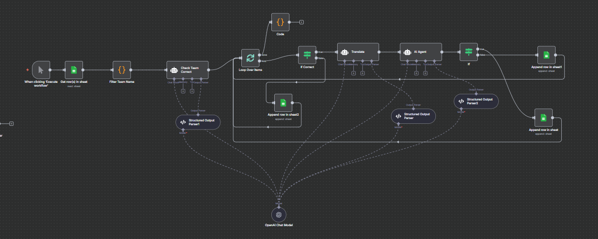

# Search New Team - n8n Workflow

## Overview

This n8n workflow automates the process of validating soccer team names and translating them into multiple languages. The workflow reads team names from a Google Sheets input, verifies their correctness using AI, translates them into various languages, and writes the results back to Google Sheets.

## Workflow Purpose

The workflow performs the following main functions:
1. **Team Name Validation**: Verifies if soccer team names are correct using AI-powered fact-checking
2. **Multi-language Translation**: Translates team names into Traditional Chinese, Simplified Chinese, Vietnamese, Thai, and English
3. **Data Management**: Reads from and writes to Google Sheets for data persistence
4. **Batch Processing**: Handles multiple team names in a loop for efficient processing

## Workflow Architecture

### Workflow Diagram



*Visual representation of the Search New Team workflow showing the complete data flow from input to output*

### Trigger Nodes
- **Manual Trigger**: "When clicking 'Execute workflow'" - Allows manual execution
- **Schedule Trigger**: "Schedule Trigger" - Enables automated scheduling (currently not connected)

### Data Flow

```
Google Sheets (Input) → Filter Team Name → Check Team Correct → Loop Over Items
                                                                    ↓
                                                              if Correct
                                                                    ↓
                                                              Translate → AI Agent → If
                                                                    ↓              ↓
                                                              Append row in sheet  Append row in sheet1
```

## Node Details

### 1. Data Input
- **Get row(s) in sheet**: Reads team names from Google Sheets
  - Document ID: `1ZIFe-8bb1ViY5eCSEMYaQ0ZA6jO-49_e3hqLywAfVbQ`
  - Sheet: Input (gid=0)
  - Credentials: Google Sheets OAuth2

### 2. Data Processing
- **Filter Team Name**: Extracts team names from the input data
  - JavaScript code: `return $input.all().map(item => { return { json : { "TeamName": item.json["Team Name"] } } })`

- **Loop Over Items**: Processes items one by one (batch size = 1)

### 3. AI Validation
- **Check Team Correct**: Validates team names using AI
  - Prompt: Confirms if team name is correct for soccer sport
  - Returns: TeamName, Result (Correct/Incorrect), WebSite URLs
  - Uses OpenAI GPT-4.1-mini model

- **Structured Output Parser1**: Ensures proper JSON format for validation results

### 4. Conditional Logic
- **if Correct**: Routes data based on validation result
  - If Correct → Translation path
  - If Incorrect → Direct output path

### 5. Translation
- **Translate**: Translates team names into multiple languages
  - Languages: Traditional Chinese, Simplified Chinese, Vietnamese, Thai, English
  - Special rules for character conversion (Ø→O, Å→A, etc.)
  - Uses Google Translate tool when needed

- **Structured Output Parser**: Ensures proper JSON format for translations

### 6. Final Validation
- **AI Agent**: Performs final fact-checking on translated names
  - System message: Fact-checking assistant for soccer team names
  - Searches authoritative sources (Google, Wikipedia, UEFA, ESPN)
  - Returns Correct/Incorrect status

- **If**: Routes based on final validation result

### 7. Data Output
Three different output paths based on validation results:

#### Path 1: Complete Data (All Languages)
- **Append row in sheet**: Writes complete data including all translations
- Output columns: TeamName, Result, WebSite, Traditional Chinese, Simplified Chinese, Vietnamese, Thai, English

#### Path 2: Partial Data (English Only)
- **Append row in sheet1**: Writes data with English translation only
- Output columns: TeamName, Result, WebSite, English

#### Path 3: Basic Data (No Translation)
- **Append row in sheet2**: Writes basic validation data without translations
- Output columns: TeamName, Result, WebSite

## Configuration

### Google Sheets Setup
- **Input Sheet**: Contains team names in "Team Name" column
- **Output Sheet**: Receives processed results (gid=85741646)
- **Credentials**: Google Sheets OAuth2 API

### OpenAI Configuration
- **Model**: GPT-4.1-mini
- **Credentials**: OpenAI API key required

### Translation Rules
1. **Traditional Chinese**: Must remain in Chinese characters only
2. **Simplified Chinese**: Must remain in Chinese characters only
3. **Vietnamese**: Standard Vietnamese translation style
4. **Thai**: Standard Thai translation style
5. **English**: Convert non-English characters to English equivalents

## Workflow Execution

### Manual Execution
1. Click "Execute workflow" trigger
2. Workflow reads team names from Google Sheets
3. Processes each team name through validation and translation
4. Writes results back to Google Sheets

### Automated Execution
- Schedule trigger available but not currently connected
- Can be configured for periodic execution

## Output Schema

The workflow produces data with the following structure:

```json
{
  "TeamName": "string",
  "Result": "Correct|Incorrect",
  "WebSite": ["url1", "url2"],
  "Traditional Chinese": "string",
  "Simplified Chinese": "string",
  "Vietnamese": "string",
  "Thai": "string",
  "English": "string"
}
```

## Error Handling

- **Structured Output Parsers**: Ensure proper JSON formatting
- **Conditional Logic**: Routes data based on validation results
- **Batch Processing**: Handles individual items to prevent bulk failures

## Dependencies

- n8n workflow automation platform
- Google Sheets API access
- OpenAI API access
- Google Translate API (via AI agent)

## Usage Notes

1. Ensure Google Sheets credentials are properly configured
2. OpenAI API key must be valid and have sufficient credits
3. Input data should have "Team Name" column in the specified Google Sheet
4. Output will be written to the designated output sheet
5. Workflow processes one team at a time for reliability

## Workflow Status

- **Active**: No (currently inactive)
- **Version**: c53c1265-46d5-4db2-94a1-6facc2abc182
- **Execution Order**: v1
